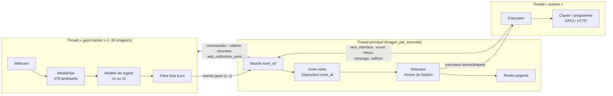
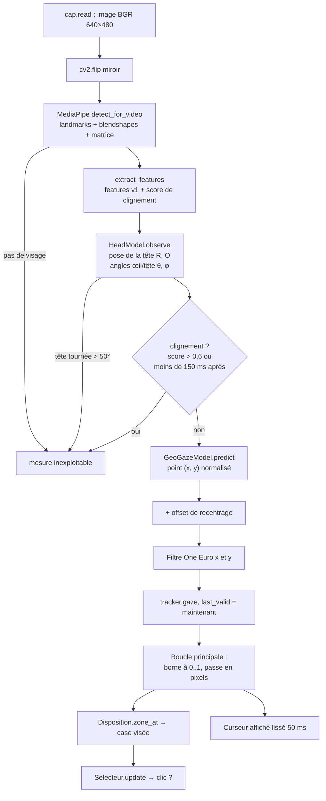

# Fonctionnement détaillé du code

Ce document explique comment le projet transforme une webcam en « souris oculaire » : de l'image caméra jusqu'à l'action déclenchée. Il suit le code réel du dossier [victor/](victor/). Chaque section renvoie aux fichiers et fonctions concernés.

## Sommaire

1. [Vue d'ensemble](#1-vue-densemble)
2. [Lancer le programme](#2-lancer-le-programme)
3. [Ce qui se passe pour une image caméra](#3-ce-qui-se-passe-pour-une-image-caméra)
4. [MediaPipe et les landmarks](#4-mediapipe-et-les-landmarks)
5. [Tracker v1 : régression 2D (`utils.py`)](#5-tracker-v1--régression-2d-utilspy)
6. [Tracker v2 : modèle géométrique 3D (`utils_v2.py`)](#6-tracker-v2--modèle-géométrique-3d-utils_v2py)
7. [Traitements communs : clignements, filtre, recentrage](#7-traitements-communs--clignements-filtre-recentrage)
8. [Boucle principale (`main_v2.py`)](#8-boucle-principale-main_v2py)
9. [Interface graphique (`interface.py`)](#9-interface-graphique-interfacepy)
10. [Configuration (`config.py`, `config.yaml`)](#10-configuration-configpy-configyaml)
11. [Actions (`actions.py`)](#11-actions-actionspy)
12. [Prototypes à la racine](#12-prototypes-à-la-racine)
13. [Points d'attention et limites connues](#13-points-dattention-et-limites-connues)

---

## 1. Vue d'ensemble

L'utilisateur fixe un bouton à l'écran ; au bout de `duree_clic` secondes (2 s par défaut), un anneau de progression se remplit et l'action du bouton se déclenche. Une action peut être un raccourci clavier, un texte tapé, un programme lancé, une broche GPIO du Raspberry Pi ou une requête HTTP vers un appareil du réseau local. Les menus et les boutons sont décrits dans un fichier YAML, TOML ou JSON ; on n'a pas besoin de toucher au code pour les modifier.

### Fichiers

| Fichier | Rôle | Dépend de |
| --- | --- | --- |
| [victor/main_v2.py](victor/main_v2.py) | Point d'entrée actuel : boucle principale, navigation, sélection par fixation | tout le reste |
| [victor/main.py](victor/main.py) | Même boucle, branchée sur le tracker v1 (sans recalibration au clic) | idem |
| [victor/utils_v2.py](victor/utils_v2.py) | Tracker v2 : modèle 3D tête + yeux, calibration, recalibration continue | `utils.py`, MediaPipe, OpenCV, NumPy |
| [victor/utils.py](victor/utils.py) | Tracker v1 (régression ridge 2D) et briques partagées : indices des landmarks, filtre One Euro, extraction des features, téléchargement du modèle | MediaPipe, OpenCV, NumPy |
| [victor/interface.py](victor/interface.py) | Découpage de l'écran en zones et rendu pygame | pygame, OpenCV |
| [victor/config.py](victor/config.py) | Lecture, fusion avec les valeurs par défaut et validation de la configuration | `actions.py`, PyYAML, `tomllib` |
| [victor/actions.py](victor/actions.py) | Registre des actions, analyse de leur syntaxe, exécution dans un thread | gpiozero (optionnel) |
| [victor/config.yaml](victor/config.yaml) | Configuration utilisée par défaut (menus, réglages), avec sa documentation en commentaires | — |
| [victor/exemples/](victor/exemples/) | La même configuration en TOML et en JSON | — |
| [models/face_landmarker.task](models/face_landmarker.task) | Réseau de neurones MediaPipe de détection du visage (téléchargé automatiquement s'il manque) | — |

### Les trois threads



Les threads ne partagent que des valeurs simples et des files `queue.Queue` :

- Le **thread tracker** écrit `tracker.gaze` (un nouveau tableau NumPy à chaque image, donc remplacé d'un coup) et `tracker.last_valid` (horodatage de la dernière mesure exploitable). La boucle principale les lit sans verrou.
- Toutes les commandes envoyées au tracker (`start_calibration`, `recenter`, `reset`, `add_calibration_point`…) sont des fonctions mises dans `tracker._cmds`. Le thread tracker les exécute au début de son image suivante. Ainsi, l'état interne du tracker n'est modifié que par son propre thread.
- Le **thread actions** reçoit des séquences d'actions dans `Executeur._travaux` et renvoie les ordres qui concernent l'interface (navigation, message) dans `Executeur.vers_interface`.

Résultat : un `attendre 2` dans un bouton ne fige pas l'interface, et une calibration lourde (ajustement non linéaire, environ une seconde) ne fige pas l'affichage.

---

## 2. Lancer le programme

```bash
cd victor
python main_v2.py                  # config.yaml (ou .yml/.toml/.json) à côté du script
python main_v2.py mon_layout.toml  # autre fichier de configuration
python main_v2.py --souris         # la souris remplace le regard (tester un layout sans caméra)
```

Dépendances : `mediapipe`, `opencv-python`, `numpy`, `pygame`, `pyyaml`, et `gpiozero` en option sur Raspberry Pi. `tomllib` impose Python ≥ 3.11.

Au démarrage, `main()` :

1. sépare les arguments : le premier argument qui ne commence pas par `--` est le chemin de la configuration ; sinon `config.chercher()` prend le premier `config.yaml`, `config.yml`, `config.toml` ou `config.json` trouvé à côté du script ;
2. charge la configuration (`config.charger`). En cas d'erreur, affiche **toutes** les erreurs d'un coup puis quitte avec le code 1 ;
3. initialise pygame et la fenêtre (plein écran ou fenêtre redimensionnable) et construit le rendu ;
4. crée le tracker : `TrackerSouris` avec `--souris`, sinon `utils_v2.GazeTracker`. MediaPipe est importé seulement à ce moment-là parce qu'il est long à charger ; le mode souris démarre donc instantanément ;
5. lance le thread du tracker (`tracker.start()`), crée `Navigation`, `Selecteur` et `Executeur`, puis entre dans la boucle.

### Touches clavier

| Touche | Effet |
| --- | --- |
| `C` | Lance la calibration |
| `Échap` | Annule la calibration en cours ; sinon quitte |
| `Espace` | Recentre : la position actuelle du regard devient le centre de l'écran |
| `R` | Oublie complètement la calibration |
| `D` | Affiche ou masque la vignette caméra annotée (debug) |
| `F` | Bascule plein écran / fenêtre |

---

## 3. Ce qui se passe pour une image caméra

Le schéma suit une image dans le tracker v2 une fois la calibration faite. Tout ce qui est à gauche de `tracker.gaze` se passe dans le thread tracker, le reste dans le thread principal.



Une image inexploitable ne modifie pas `tracker.gaze`. Si aucune mesure exploitable n'arrive pendant `delai_perte_regard` (0,5 s), `gaze_fresh()` renvoie `False` : la boucle principale ne vise plus aucune case et le chrono de fixation est remis à zéro.

---

## 4. MediaPipe et les landmarks

Les deux trackers utilisent **MediaPipe Face Landmarker** en mode `VIDEO` :

- `num_faces=1` : le lissage temporel interne de MediaPipe ne fonctionne qu'avec un seul visage ;
- `output_face_blendshapes=True` : 52 scores d'expression, dont `eyeBlinkLeft/Right` (clignement) et `eyeLookUp/Down…` (regard vertical) ;
- `output_facial_transformation_matrixes=True` : matrice de pose de la tête (utilisée par la v1) ;
- seuils de confiance de détection, de présence et de suivi à 0,5.

`ensure_model()` ([victor/utils.py](victor/utils.py)) télécharge le fichier `.task` vers `models/face_landmarker.task` s'il est absent. Le téléchargement passe par un fichier `.part` puis par `os.replace`, pour ne jamais laisser de fichier à moitié écrit.

Chaque image est d'abord retournée en miroir (`cv2.flip(image, 1)`), puis convertie de BGR en RGB. Le mode `VIDEO` impose des horodatages strictement croissants : `step()` calcule `ts = millisecondes depuis le démarrage` et force `ts = last_ts + 1` si deux images tombent sur la même milliseconde.

### Points du visage utilisés

MediaPipe renvoie 478 points `(x, y, z)` : x et y sont normalisés par la taille de l'image, z est une profondeur relative à la même échelle que x. Les indices utilisés sont définis dans [victor/utils.py](victor/utils.py) :

| Point | Œil A (gauche de l'image) | Œil B (droite de l'image) |
| --- | --- | --- |
| Coin extérieur | 33 | 263 |
| Coin intérieur | 133 | 362 |
| Paupière haute | 159 | 386 |
| Paupière basse | 145 | 374 |
| Centre de l'iris | 468 | 473 |
| Contour de l'iris | 469–472 | 474–477 |

Le bout du nez (point 1) sert à la position de la tête dans la v1. Les deux coins de chaque œil sont triés par x dans le code. Le miroir ne pose donc pas de problème : « A » désigne toujours l'œil situé à gauche de l'image affichée.

---

## 5. Tracker v1 : régression 2D (`utils.py`)

La v1 est une **régression** : elle apprend directement « features mesurées → point de l'écran » à partir des points de calibration. Elle est encore utilisée par `main.py`, et la v2 lui emprunte plusieurs briques.

### 5.1 Features extraites à chaque image

`eye_features(lm, eye, w, h)` travaille **en pixels**, dans un repère propre à chaque œil :

- `u` = vecteur unitaire du coin gauche vers le coin droit de l'œil ; `v` = sa perpendiculaire, orientée vers le bas ;
- `width` = distance entre les deux coins : toutes les mesures sont divisées par cette largeur, ce qui les rend indépendantes de la distance à la caméra ;
- `fx`, `fy` = position de l'iris par rapport au milieu des deux coins, projetée sur `u` et `v` ;
- `fl` = position verticale de l'iris par rapport au milieu des paupières ;
- `ap` = ouverture de l'œil (distance entre les paupières / largeur).

Mesurer dans le repère des coins rend la mesure insensible à l'inclinaison de la tête (roll). Normaliser par la largeur plutôt que par la hauteur évite l'instabilité de l'ancien ratio « iris / hauteur de l'œil » : quand on regarde en bas, la paupière descend avec l'iris.

`extract_features(result, w, h)` moyenne les deux yeux et construit un vecteur de 10 features :

| Index | Nom | Signification |
| --- | --- | --- |
| 0 | `fx` | iris horizontal dans l'œil |
| 1 | `fy` | iris vertical par rapport aux coins |
| 2 | `fl` | iris vertical par rapport aux paupières |
| 3 | `bv` | blendshapes `eyeLookDown − eyeLookUp` (aide pour le vertical) |
| 4 | `ap` | ouverture de l'œil |
| 5 | `yaw` | rotation gauche-droite de la tête (degrés) |
| 6 | `pitch` | rotation haut-bas de la tête (degrés) |
| 7 | `hx` | position x du nez dans l'image |
| 8 | `hy` | position y du nez dans l'image |
| 9 | `hs` | distance entre les coins extérieurs / largeur de l'image (≈ 1 / distance à la caméra) |

La fonction renvoie aussi le **score de clignement** : la moyenne de `eyeBlinkLeft` et `eyeBlinkRight`. Sans blendshapes, le repli est `ap < 0,08` ⇒ œil fermé.

`yaw` et `pitch` viennent de `head_pose(result)`, qui extrait les angles d'Euler de la matrice de transformation MediaPipe (après normalisation des colonnes pour enlever l'échelle).

### 5.2 Modèle : régression ridge pondérée (`GazeModel`)

`design_matrix` ajoute trois termes quadratiques aux 10 features : `fx²`, `fy²` et `fx·fy`, soit 13 colonnes. L'ajustement (`fit`) se fait ainsi :

1. chaque colonne est standardisée (moyenne et écart-type pondérés). L'écart-type est borné par en dessous (`SD_FLOORS`) pour ne pas amplifier une feature qui n'a presque pas varié pendant la calibration, typiquement la tête ;
2. on résout une régression ridge pondérée :

$$ w = \left(X^\top W X + \lambda\, n\, \mathrm{diag}(P)\right)^{-1} X^\top W (y - \bar y)
$$


avec $W$ les poids des échantillons, $P$ la pénalité par colonne (4 pour les termes quadratiques, 1 sinon) et λ choisi parmi `(0.002, 0.01, 0.05, 0.2, 1.0)`.

À la prédiction, les colonnes « tête » sont bornées à ±3 écarts-types appris (`HEAD_CLIP_Z`) : une pose jamais vue pendant la calibration ne peut pas envoyer le curseur n'importe où.

### 5.3 Calibration v1 (`Calibration`)

C'est une machine à états qui affiche une cible à la fois :

- 16 cibles sur une grille 4×4, avec une marge de 5 % sur les bords, **dans un ordre aléatoire** pour que l'œil n'anticipe pas la cible suivante ;
- 2,5 s de préparation avant la première cible (le temps de lire la consigne) ;
- pour chaque cible : 0,8 s de stabilisation (échantillons jetés), puis 2,0 s de collecte ;
- consigne : garder les yeux sur la cible **en bougeant doucement la tête**. C'est ce mouvement qui permet à la régression d'apprendre la compensation de la tête ;
- une cible est validée avec au moins 15 échantillons après rejet des aberrants (écart à la médiane > 5 MAD sur `fx`, `fy`). Sinon elle est recommencée jusqu'à 2 fois, puis ignorée ;
- il faut au moins 10 cibles validées. Durée totale : environ 47 s.

L'ajustement (`Calibration.fit`) :

1. choisit λ par **validation croisée « une cible laissée de côté »** (LOPO) : pour chaque λ, on réentraîne en retirant une cible entière, on mesure l'erreur sur cette cible, et on garde le λ qui minimise l'erreur moyenne ;
2. pondère chaque échantillon par `1 / (nombre d'échantillons de sa cible)`, pour que chaque cible compte autant ;
3. retire les échantillons dont le résidu dépasse `médiane + 3,5 MAD` (si au moins 70 % restent), puis réajuste ;
4. affiche l'erreur d'entraînement et l'erreur LOPO en % de la fenêtre. Il prévient si la tête n'a pas assez bougé (écart-type de yaw et de pitch < 0,8°) ou si l'erreur validée dépasse 12 %.

Au-delà de 40° de yaw ou de 35° de pitch, la mesure est ignorée. Avant toute calibration, `fallback_gaze` donne un curseur approximatif : `x = 0,5 + 3·fx`, `y = 0,5 + 6·fy`.

**Limite de la v1** : si la tête bouge peu pendant la calibration, les coefficients de tête sont mal appris (la ridge les écrase vers 0). Le curseur dérive alors dès que la tête bouge en utilisation. C'est ce qui a motivé la v2.

---

## 6. Tracker v2 : modèle géométrique 3D (`utils_v2.py`)

La v2 ne cherche plus à *apprendre* comment la tête influence le point regardé : elle le *calcule* par géométrie. Elle reconstruit la tête en 3D, place les globes oculaires dedans, en déduit un rayon de regard en 3D et l'intersecte avec le plan de l'écran. Tourner ou déplacer la tête change la pose et l'origine du rayon, et la géométrie compense d'elle-même.

L'API est la même que la v1 (`gaze`, `calibrating`, `calibrated`, `start_calibration`…). La v2 ajoute `head_pose`, `calibration_hint`, `add_calibration_point`, `save_calibration` et `load_calibration`.

### 6.1 Repères et conventions

- **Repère caméra** (cm) : origine au centre optique, x vers la droite de l'image, y vers le bas,  z vers l'avant (vers l'utilisateur).
- **Repère tête** (cm) : x de l'œil A vers l'œil B, y vers le bas du visage, z vers l'arrière du crâne (normale au visage).
- **Regard en sortie** : `(x, y)` normalisés dans la fenêtre, de 0 à 1.

### 6.2 Caméra sténopé (`Camera`)

La webcam est modélisée par une caméra sténopé dont le centre optique est au milieu de l'image. La focale vient d'un champ horizontal supposé de 60° :

$$ f = \frac{w/2}{\tan(\mathrm{HFOV}/2)} \quad\Rightarrow\quad f \approx 554\ \text{px pour } w = 640
$$

Cette focale n'est qu'un point de départ : la calibration ajuste un facteur de correction (paramètre `P_KF`).

`Camera.ray(px)` donne la direction 3D du rayon qui passe par un pixel : `((u − cx)/f, (v − cy)/f, 1)`.

`Camera.backproject(lmk)` remonte les landmarks rigides en 3D **à un facteur d'échelle près**. MediaPipe donne `(u, v)`, qui est une projection perspective exacte, et `z`, un écart de profondeur exprimé en pixels. Un point est donc à la profondeur `Z = Z0·(1 + z/f)`, et sa position 3D vaut :

$$
P = Z_0 \left(1 + \frac{z}{f}\right) \begin{pmatrix} (u - c_x)/f \\ (v - c_y)/f \\ 1 \end{pmatrix}
$$

`Z0` (la distance de la tête) est inconnu, mais tous les points lui sont proportionnels : il ressortira comme facteur d'échelle de l'alignement de Procrustes. Il n'y a aucune approximation orthographique, donc une tête décalée sur le côté ou proche de la caméra reste correctement traitée.

### 6.3 Alignement de Procrustes (`umeyama`)

`umeyama(x, y, wts)` trouve la similarité (échelle `s`, rotation `R`, translation `t`) qui minimise la somme pondérée des écarts :

$$ 
\min_{s, R, t} \sum_i w_i \left\| y_i - (s R x_i + t) \right\|^2
$$

La solution est fermée : on centre les deux nuages, on fait une SVD de leur covariance pondérée, puis on corrige le signe pour obtenir une vraie rotation (déterminant +1) et non une réflexion. Cette fonction sert à la fois à construire le modèle de tête et à estimer la pose à chaque image.

### 6.4 Modèle de tête propre à l'utilisateur (`HeadModel.build`)

Il est construit **une fois, à la fin de la calibration**, à partir de toutes les images collectées :

1. Seuls 69 points **rigides** sont gardés (`RIGID_IDX`) : nez, front, coins et orbites des yeux, pommettes, tempes. La bouche, la mâchoire, les sourcils et les paupières sont exclus parce qu'ils bougent avec les expressions.
2. Au plus 150 images, réparties uniformément, sont rétroprojetées en 3D.
3. **Procrustes généralisé**, 4 itérations : chaque nuage est aligné sur la référence, puis la référence devient la **médiane** point par point des nuages alignés (la médiane rejette les images aberrantes), recentrée et normalisée.
4. **Échelle métrique** : on mesure la distance entre les milieux des coins des deux yeux et on la fixe à la distance inter-pupillaire moyenne, `IPD_CM = 6,3 cm`. Le modèle est maintenant en centimètres.
5. **Repère du visage** : z = direction de moindre variance du nuage (normale au visage, par SVD), orientée vers l'arrière ; x = direction œil A → œil B, rendue orthogonale à z ; y = z × x.
6. **Globes oculaires** : le centre de chaque globe est placé au milieu des coins de l'œil, puis reculé de `EYE_DEPTH_CM = 1,0 cm` le long de z.

Le modèle stocke donc la forme 3D rigide (`pts`) et les deux centres des globes (`eyes`), en cm, dans le repère tête.

### 6.5 Pose de la tête à chaque image (`HeadModel.pose`)

Les landmarks de l'image sont rétroprojetés (à l'échelle `1/Z0` près), puis `umeyama` aligne le modèle sur eux : `q ≈ s·R·pts + t`. Comme `q` est proportionnel à `1/Z0`, on obtient directement :

- `R` : la rotation tête → caméra ;
- `t / s` : la position de l'origine du modèle en cm, dans le repère caméra.

L'estimation est **robuste** : deux passes de repondération donnent à chaque point un poids `1 / (1 + (résidu / 2,5σ)²)`, avec `σ = 1,4826 × médiane des résidus`. Un landmark mal placé ou masqué pèse donc peu.

`euler_deg(R)` convertit la rotation en (yaw, pitch, roll) pour l'affichage et pour le garde-fou : au-delà de **50°** de yaw ou de pitch (`MAX_HEAD_ANGLE_DEG`), la mesure est jetée.

### 6.6 Direction des yeux (`HeadModel.observe`)

Pour chaque œil :

1. le centre du globe est passé dans le repère caméra : `e = centre + R · eye` ;
2. on projette les deux centres à l'écran et on associe chaque iris au globe le plus proche (une simple sécurité) ;
3. on trace le rayon caméra qui passe par le pixel de l'iris et on l'**intersecte avec la sphère** de rayon `EYE_RADIUS_CM = 1,15 cm` centrée sur le globe. On résout `‖λ·ray − e‖² = r²` en prenant la racine la plus proche, c'est-à-dire la face avant du globe. Si le rayon manque la sphère, on prend le point du rayon le plus proche du centre (`λ = b/a`) ;
4. l'axe optique est le vecteur `centre du globe → iris`, ramené dans le **repère tête** par `Rᵀ`.

Les deux axes sont moyennés, puis convertis en deux angles **œil/tête** :

$$
\theta = \operatorname{atan2}(v_x, -v_z), \qquad \varphi = \operatorname{atan2}\!\left(v_y, \sqrt{v_x^2 + v_z^2}\right)
$$

Ces angles décrivent où l'œil regarde **par rapport à la tête**. Ils ne dépendent pas de la pose. `observe` renvoie aussi `O`, le milieu des deux globes dans le repère caméra (en cm) : c'est l'origine du rayon de regard.

### 6.7 Du rayon de regard au point de l'écran (`GeoGazeModel`)

Le modèle a **23 paramètres** :

| Indices | Nom | Rôle |
| --- | --- | --- |
| 0–5 | `P_SCREEN` | Transformation affine du plan de l'écran (cm) vers la fenêtre (0..1) |
| 6–12 | `P_TH` | Correction de l'angle horizontal θ |
| 13–19 | `P_PH` | Correction de l'angle vertical φ |
| 20–21 | `P_TILT` | Inclinaison du plan de l'écran autour de x et de y |
| 22 | `P_KF` | log du facteur de correction de focale / distance |

`predict_with(p, obs)` calcule :

1. **Correction des angles** : avec la base `f = [1, θ, φ, θ², φ², θφ, bv]` (`bv` = blendshapes haut/bas),

$$
\theta' = \theta + f \cdot p_{TH}, \qquad \varphi' = \varphi + f \cdot p_{PH}
$$

   Le terme constant correspond à l'angle *kappa* (décalage entre l'axe optique et l'axe visuel, propre à chaque personne). Le terme linéaire est un gain, les termes quadratiques corrigent les déformations, et `bv` aide sur le vertical, où l'iris bouge peu.

2. **Direction du regard** dans le repère tête, puis dans le repère caméra :

$$
g_h = (\cos\varphi' \sin\theta',\ \sin\varphi',\ -\cos\varphi' \cos\theta'), \qquad g = R\, g_h
$$

3. **Origine** : `O`, dont la composante z est multipliée par `exp(p_KF)`, ce qui corrige une erreur d'échelle sur la distance (due à la focale supposée ou à l'IPD moyenne).

4. **Intersection avec le plan de l'écran** : le plan passe par la caméra (l'écran est juste à côté d'elle) et sa normale `n` est donnée par les deux angles d'inclinaison (`rot_x(tilt_x) · rot_y(tilt_y)`). Le point d'impact vaut `pt = O + t·g` avec `t = −(O·n)/(g·n)`. Si le regard s'éloigne de l'écran (`g·n` proche de 0 ou positif), le dénominateur est borné à −0,01 pour éviter une division par zéro.

5. **Coordonnées dans le plan** `(a, b)` (cm), puis affine vers la fenêtre : `x = s0·a + s1·b + s2`, `y = s3·a + s4·b + s5`.

### 6.8 Ajustement : moindres carrés non linéaires robustes

`GeoGazeModel.fit` :

1. **Départ** : correction des angles nulle, puis l'affine est estimée par moindres carrés linéaires pondérés, ce qui donne un premier point de départ cohérent ;
2. **Résidus** : pour chaque échantillon, l'écart prédiction − cible est divisé par `FIT_SIGMA = 0,03` (3 % de la fenêtre, le bruit typique) puis passé dans une **perte soft-L1** :

$$
\rho(r) = 2\left(\sqrt{1 + r^2} - 1\right)
$$

   Cette perte est quadratique pour les petites erreurs et linéaire pour les grandes : un échantillon aberrant ne tire pas tout le modèle ;
3. **A priori** : un résidu `p / PRIOR_SIGMA` est ajouté pour chaque paramètre de correction, d'inclinaison et de focale. Ces paramètres restent ainsi proches de 0 tant que les données ne les justifient pas. L'affine n'a pas d'a priori ;
4. **Levenberg-Marquardt** maison (`levenberg_marquardt`) : jacobienne par différences finies, amortissement de Marquardt sur la diagonale, 60 itérations au plus. Le facteur μ est multiplié par 4 tant que le coût ne baisse pas et divisé par 3 après chaque succès.

### 6.9 Calibration v2 (`Calibration3D`)

Elle se fait en deux phases :

| Phase | Cibles | Stabilisation | Collecte | Minimum d'échantillons | Consigne |
| --- | --- | --- | --- | --- | --- |
| Tête fixe | 16 (grille 4×4, ordre aléatoire) | 0,8 s | 2,0 s | 15 | « Fixe le point, tête immobile » |
| Tête en mouvement | 3 : (0,5 ; 0,5), (0,25 ; 0,3), (0,75 ; 0,7) | 1,0 s | 4,5 s | 30 | « Garde les yeux sur le point et bouge doucement la tête » |

Durée totale : environ 61 s. Comme en v1, une cible ratée est recommencée jusqu'à 2 fois, puis ignorée.

Particularité : la v2 garde les **landmarks bruts** de chaque échantillon, et non des mesures. Le modèle de tête n'existe pas encore pendant la calibration ; il est construit à la fin à partir de toutes les images, puis chaque échantillon est remesuré avec lui.

`Calibration3D.fit(cam)` :

1. vérifie qu'il y a au moins 10 cibles fixes validées ;
2. construit le `HeadModel` et calcule `observe` pour chaque échantillon ;
3. rejette les aberrants des cibles fixes : angles θ, φ à plus de 3,5 MAD de la médiane de la cible (plancher 0,003 rad). Cela élimine les clignements partiels et les saccades ;
4. pondère : chaque cible pèse au total 1, ou 3 pour une cible « tête en mouvement » (`HEAD_GROUP_WEIGHT`), puis les poids sont normalisés à une moyenne de 1 ;
5. ajuste le `GeoGazeModel` ;
6. calcule trois erreurs, affichées en % de la fenêtre : entraînement (cibles fixes), **LOPO** (chaque cible fixe retirée tour à tour, 3 itérations de réajustement à partir du modèle complet) et « tête en mouvement ».

La phase « tête en mouvement » est essentielle. Tête immobile, plusieurs paramètres ne se distinguent pas : le gain réel des angles d'œil et l'échelle de distance donnent le même point à l'écran. Faire bouger la tête en gardant les yeux sur la cible sépare ces effets.

### 6.10 Recalibration continue au clic

Chaque clic sur une case est l'occasion d'apprendre : on sait à peu près ce que l'utilisateur regardait pendant les instants qui précèdent le clic. Le mécanisme a deux parties.

**Côté boucle principale** ([victor/main_v2.py](victor/main_v2.py)) : quand un bouton est déclenché (et que `recalibration_clic` est actif, hors mode souris et après calibration), la cible donnée au tracker est un mélange du centre de la case et de la position du regard au moment du clic :

$$
\text{cible} = a \cdot \text{centre de la case} + (1 - a) \cdot \text{regard}, \qquad a = \texttt{recalibration\_part\_centre}
$$

Avec `a = 1`, on suppose que l'utilisateur visait exactement le centre ; avec `a = 0`, on ne corrige rien. La valeur 0,65 du fichier de config est un compromis : on ne vise jamais exactement le centre d'un grand bouton.

**Côté tracker** (`add_calibration_point`) :

1. Le tracker garde en permanence les 300 dernières mesures dans `_recent`, soit environ 10 s : `(instant, observation 3D, bv)`.
2. Au clic, il prend les mesures des `recalibration_fenetre` secondes (0,4 s) qui précèdent l'instant du clic. Il en faut au moins 3. Comme la fixation dure `duree_clic` (2 s), ces images sont bien prises pendant que l'œil était posé sur le bouton.
3. Le point `(observations, cible − offset)` est ajouté à une **fenêtre glissante** de `recalibration_points_max` points (20). L'offset de recentrage est retiré, parce que le modèle prédit le regard avant recentrage.
4. `_refit_recal` réajuste **seulement 4 paramètres** (`RECAL_PARAMS = [6, 13, 7, 15]`) : l'offset de θ, l'offset de φ, le gain de θ et le gain de φ. Ces corrections portent sur les angles œil/tête : elles restent donc valables quand la tête bouge, contrairement à un simple décalage du curseur.
5. Poids d'un point d'âge `k` (0 = le plus récent) : `recalibration_poids × recalibration_oubli^k`, réparti entre ses images. Les vieux clics s'effacent exponentiellement.
6. La calibration (C) reste l'**ancre** : elle n'est pas réajustée, et un a priori `δ / RECAL_SIGMA` (0,15 rad pour les offsets, 0,2 pour les gains) ramène la correction vers 0. Quelques clics mal placés ne peuvent donc pas détruire la calibration.
7. Levenberg-Marquardt en 15 itérations au plus, en repartant de la correction précédente. Le nouveau modèle vaut `paramètres de base + δ`.

`R` (reset) et une nouvelle calibration effacent tous les points de recalibration (`_clear_recal`).

### 6.11 Sauvegarde de la calibration

`save_calibration(path)` écrit un `.npz` avec la forme de la tête, les centres des globes, le rapport `focale / largeur` et les paramètres du modèle de base. `load_calibration(path)` les recharge, en recréant la caméra si aucune image n'a encore été lue. **Ces deux méthodes ne sont appelées nulle part pour l'instant** : il faut recalibrer à chaque lancement (voir la [ROADMAP](ROADMAP.md)).

### 6.12 Avant la calibration

Tant qu'il n'y a pas de modèle, la v2 utilise le `fallback_gaze` de la v1 : le curseur bouge à peu près dans la bonne direction, ce qui suffit pour s'installer.

---

## 7. Traitements communs : clignements, filtre, recentrage

Ces mécanismes sont identiques dans les deux trackers (`step()`).

### Clignements

Si le score de clignement dépasse `seuil_clignement` (0,6), l'image est jetée **et** les 0,15 s suivantes aussi (`BLINK_HOLD_S`), le temps que la paupière remonte. Sans cela, chaque clignement ferait sauter le curseur vers le bas. Pendant la calibration, ces images ne sont pas collectées.

### Filtre One Euro

Chaque coordonnée (x, y) passe dans un **filtre One Euro** (Casiez et al., 2012), c'est-à-dire un passe-bas dont la fréquence de coupure augmente avec la vitesse :

$$
f_c = f_{\min} + \beta\, |\hat{\dot x}|, \qquad \alpha = \frac{1}{1 + \tau/\Delta t}, \quad \tau = \frac{1}{2\pi f_c}, \qquad \hat x_t = \alpha x_t + (1 - \alpha)\hat x_{t-1}
$$

- Regard fixe : vitesse faible ⇒ coupure basse (`filtre_stabilite`, 0,6 Hz) ⇒ curseur très stable.
- Saccade : vitesse forte ⇒ coupure haute (× `filtre_reactivite`, β = 3) ⇒ peu de retard.
- La vitesse elle-même est lissée avec une coupure fixe de 1 Hz.

Les filtres sont réinitialisés après une calibration, un recentrage ou un reset.

### Recentrage (touche Espace)

Le tracker garde les 20 dernières prédictions brutes (`raw_hist`). Au recentrage, l'offset devient `0,5 − moyenne(raw_hist)` : l'endroit regardé à ce moment-là devient le centre de la fenêtre. L'offset est ajouté à toutes les prédictions suivantes.

### Fraîcheur du regard

`gaze_fresh(max_age)` renvoie `True` si la dernière mesure exploitable date de moins de `max_age` secondes. La boucle principale l'appelle avec `delai_perte_regard` (0,5 s). Au-delà, le curseur devient gris (« perdu ») et aucune case n'est visée.

---

## 8. Boucle principale (`main_v2.py`)

### 8.1 Classes de soutien

**`Navigation`** : une **pile** de `[menu, page]`.

- Au départ : `[["principal", 0]]`.
- `ouvrir(m)` empile, `retour()` dépile (sans jamais vider la pile), `accueil()` ne garde que le menu principal.
- Un menu est découpé en pages de `lignes × colonnes` boutons. `boutons()` renvoie la page courante, complétée par des `None` (cases vides).
- `defiler(±1)` change de page de façon **circulaire** (après la dernière page, on revient à la première).
- `fil()` construit le fil d'Ariane affiché en haut : `Accueil › Raccourcis › Navigateur`.

**`Selecteur`** : le chrono de fixation.

- `update(cible, now, duree, repeter)` : si la cible change, le chrono repart à zéro. Si le regard reste `duree` secondes sur la même cible, la fonction renvoie `True` (clic).
- Après un clic, la cible est **bloquée** : il faut la quitter puis revenir pour recliquer. Cela évite les clics en rafale.
- Exception : avec `repeter=True` (bandes de défilement), le chrono redémarre aussitôt. En restant sur une bande, on fait défiler une page toutes les `duree_clic` secondes.
- `bloquer()` est appelé après une navigation : le nouveau bouton qui apparaît sous le regard ne doit pas se déclencher tout seul.
- `progression()` renvoie la fraction 0..1 qui sert à dessiner l'anneau.

**`TrackerSouris`** : imite l'API du tracker avec la position de la souris. Il est « calibré » en permanence et `gaze_fresh` vaut `True` tant que la souris est dans la fenêtre. Il sert à tester une configuration sans caméra.

### 8.2 Une itération de la boucle

La boucle tourne tant que `tracker.alive` est vrai (la caméra répond), à `images_par_seconde` (30) grâce à `pygame.time.Clock.tick`.

1. **Événements pygame** : fermeture, redimensionnement (on reconstruit le rendu), touches (section 2).
2. **Commandes du thread actions** : on vide `executeur.vers_interface` :
   - `message` → bulle à l'écran ;
   - `calibrer` → `tracker.start_calibration()` ;
   - `ouvrir` / `retour` / `accueil` → `Navigation`, puis `selecteur.bloquer()`.
3. **Calibration en cours** : on dessine l'écran de calibration et la consigne (`calibration_hint`), on remet le sélecteur à zéro et on passe à l'itération suivante. À la sortie de la calibration, une bulle affiche « Calibration terminée » ou « Calibration annulée ».
4. **Regard → pixels** : `tracker.gaze` est borné à [0, 1] puis multiplié par la taille de la fenêtre.
5. **Curseur affiché** : il est lissé par une exponentielle de constante de temps 50 ms (`k = 1 − exp(−dt / 0,05)`), parce que l'écran se rafraîchit plus souvent que la caméra et qu'un curseur qui saute par paliers est désagréable. **La détection, elle, utilise le regard brut** : le lissage d'affichage n'ajoute pas de retard au clic.
6. **Cible et durée** : `rendu.d.zone_at(gx, gy)` donne la zone visée :
   - bande gauche ou droite : durée = `duree_clic`, seulement s'il y a plus d'une page ;
   - case contenant un bouton : durée = `duree_clic` du bouton, sinon le réglage global ; l'anneau prend la couleur du bouton ;
   - zone morte, case vide ou regard perdu : aucune durée, donc rien ne se déclenche.
7. **Clic** (`selecteur.update` renvoie `True`) :
   - un effet « pop » est lancé à l'endroit du regard ;
   - bande : `nav.defiler(±1)` et animation de glissement ;
   - bouton : point de recalibration envoyé au tracker (section 6.10), puis `executeur.lancer(bouton.etapes)`. Si le bouton ne fait pas de navigation, une bulle affiche son texte. Avec `retour_apres_action` et un sous-menu ouvert, une action `accueil` est mise en file **après** la séquence (le même thread exécute les deux dans l'ordre).
8. **Dessin** : `rendu.dessiner(...)` avec la case survolée, la progression, le curseur, l'état du regard, le pop, la couleur de l'anneau et la vignette caméra éventuelle. Le statut « Non calibré · touche C » s'affiche en haut à droite tant qu'il n'y a pas de calibration.

À la sortie (Échap, fermeture, caméra perdue), le bloc `finally` ferme le tracker (arrêt du thread, libération de la caméra et de MediaPipe) puis pygame.

### 8.3 Différences avec `main.py`

`main.py` est presque identique, mais utilise `utils.GazeTracker` (v1). Il n'a ni la consigne de calibration (`afficher_consigne`), ni les paramètres de recalibration, ni le point de recalibration au clic.

---

## 9. Interface graphique (`interface.py`)

### 9.1 Découpage de l'écran (`Disposition`)

`Disposition` calcule une fois, pour une taille de fenêtre donnée, toutes les zones en pixels. La même géométrie sert au **dessin** et à la **détection du regard**, ce qui garantit qu'on déclenche exactement ce qu'on voit.

```
+--------+------ en-tête : fil d'Ariane · pages · statut ------+--------+
|        |  +-------------------+       +-------------------+  |        |
|        |  |      Case 0       |       |      Case 1       |  |        |
|   <    |  |                   |       |                   |  |   >    |
| bande  |  +-------------------+       +-------------------+  | bande  |
| gauche |                   ( zone morte )                    | droite |
|        |  +-------------------+       +-------------------+  |        |
|        |  |      Case 2       |       |      Case 3       |  |        |
|        |  |                   |       |                   |  |        |
|        |  +-------------------+       +-------------------+  |        |
+--------+---------------------------------------------------+--------+
```

(Grille 2×2. La zone morte est un ovale au centre de l'écran, à cheval sur les quatre cases.)

- **Bandes latérales** : largeur `largeur_bandes` % de la fenêtre ; elles font défiler les pages.
- **Cases** : l'espace restant est divisé en `lignes × colonnes`. Les cases sont numérotées dans le sens de lecture (0, 1, … de gauche à droite puis de haut en bas). La première ligne commence sous l'en-tête (hauteur max(28 px, 6 % de la hauteur)). Une marge de 1,2 % sépare les cases.
- **Zone morte** : un ovale centré de demi-axes `largeur/2` % et `hauteur/2` % de la fenêtre, où le regard ne déclenche rien. C'est là que l'œil se repose. La moitié basse est une ellipse ; la moitié haute est une **super-ellipse** d'exposant `n = 2 + 8 × aplatissement_haut` (0 = ovale, 1 = dessus presque plat) :

$$
\left|\frac{x - c_x}{a}\right|^n + \left|\frac{y - c_y}{b}\right|^n \le 1
$$

`zone_at(x, y)` teste dans cet ordre : zone morte → bande gauche → bande droite → index de la case (indices bornés). Pour la détection, la bande d'en-tête compte comme la première ligne de cases.

`_segment_visible` calcule, pour chaque case, la plus grande portion verticale (sur l'axe central de la case) qui n'est pas cachée par la zone morte. Le texte et l'icône sont centrés dans cette portion et ne passent donc jamais sous l'ovale.

### 9.2 Rendu optimisé pour Raspberry Pi (`Rendu`)

L'objectif est de redessiner le moins possible :

- **Caches** : polices par taille, textes rendus (400 au plus), icônes redimensionnées, surfaces de page complètes (24 au plus), cartes en état « survolée » (48 au plus).
- **Fond statique** (`self.fond`) : page courante, en-tête, bandes, zone morte. Il n'est reconstruit que si la clé `(menu, page, nombre de pages, fil, statut)` change.
- **Rectangles sales** : à chaque image, on recopie le fond seulement sur les rectangles modifiés à l'image précédente (`self.sales`), on dessine les éléments mobiles (carte survolée, anneau, pop, bulle, vignette, curseur), et `pygame.display.update(rects)` n'envoie à l'écran que ces rectangles. Un `flip()` complet n'a lieu que si tout a changé.
- **`construire(ecran)`** recalcule la disposition, les tailles (rayon des coins, anneau, texte) et les sprites. Il est appelé au démarrage et à chaque changement de taille de fenêtre.

### 9.3 Éléments visuels

| Élément | Comment il est fait |
| --- | --- |
| Carte | Rectangle arrondi. La couleur du bouton est mélangée à 30 % au fond de la carte ; au survol, la couleur d'accent (ou celle du bouton) est mélangée à 18 % et un contour épais apparaît. Le bouton Retour a un fond plus discret. |
| Texte d'une carte | Coupé en lignes au mot près (`_couper`, avec `\n` respecté) ; la taille est réduite de 15 % jusqu'à 6 fois pour que tout tienne. |
| Bande | Chevron anti-aliasé ; trois états pré-rendus : normal, survol, inactif (une seule page). |
| Anneau de progression | Arc dessiné comme un polygone (bord extérieur + bord intérieur) autour du curseur, sur une piste grise. |
| Pop | Cercle qui grossit et s'efface en 0,35 s au moment du clic. |
| Glissement de page | 0,22 s, courbe `1 − (1 − t)³`, limité à la zone centrale (les bandes ne bougent pas). |
| Bulle de message | En bas au centre ; apparition en 0,12 s, disparition sur les 0,3 dernières secondes de `duree_message`. |
| Curseur | Point blanc avec un halo de la couleur d'accent ; gris sans halo quand le regard est perdu. |
| Indicateur de pages | Points en haut au centre, le point plein marque la page courante. |
| Vignette caméra | En bas à gauche, largeur max(160 px, 1/5 de la fenêtre), convertie seulement quand une nouvelle image arrive (`frame_id`). |

### 9.4 Écran de calibration (`dessiner_calibration`)

Il est redessiné entièrement à chaque image : fond uni, cercle-cible dont le disque intérieur rétrécit avec la progression (gris pendant la stabilisation, couleur d'accent pendant la collecte), un point central, et en haut « Calibration i/N — fixe le point (Échap = annuler) ». La v1 fournit une consigne sur deux lignes, affichée au centre de l'écran, où aucune cible n'est jamais placée. La v2 ne fournit pas de consigne dans `calibration_state()` : `main_v2.py` affiche à la place `tracker.calibration_hint` sous le titre (`afficher_consigne`).

---

## 10. Configuration (`config.py`, `config.yaml`)

### 10.1 Chargement

`charger(chemin)` :

1. **Lit le fichier** selon son extension : `.yaml`/`.yml` (PyYAML `safe_load`), `.toml` (`tomllib`) ou `.json`. Le fichier est lu en UTF-8 en tolérant le BOM ajouté par certains éditeurs. Une erreur de syntaxe est signalée avec sa ligne et sa colonne, et un conseil adapté au format. Si le fichier n'existe pas, on prend les valeurs par défaut.
2. **Fusionne** les sections `ecran`, `reglages` et `avance` avec `DEFAUTS` (`_fusionner`, récursif). Pour chaque clé :
   - clé inconnue → erreur avec une suggestion (`difflib`, par ex. « voulais-tu dire "duree_clic" ? ») ;
   - le type attendu est celui de la valeur par défaut. Booléen : `oui`/`non`/`vrai`/`faux`/ `true`/`false`. Nombre : vérifié dans `BORNES`. Liste : même longueur et uniquement des nombres. Texte : vérifié dans `CHOIX` (par ex. thème `sombre`/`clair`) ;
   - une valeur fausse produit une erreur et reprend la valeur par défaut, pour que la suite de la vérification continue.
3. **Convertit** `grille` (`"2x3"`, `"2×3"`… lignes et colonnes de 1 à 4) en tuple et `couleur_accent` en `(r, g, b)`. Noms de couleurs acceptés : rouge, vert, bleu, orange, jaune, violet, rose, gris, turquoise, marron, ou `#RRGGBB`.
4. **Lit les menus** (`_lire_menus`, détaillé ci-dessous).
5. S'il y a des erreurs, lève **une seule** `ErreurConfig` qui les liste **toutes**, avec le chemin exact de chaque clé fautive (`menus.Raccourcis, bouton 2 « Navigateur » : …`).
6. Sinon, renvoie un objet `SimpleNamespace` : on écrit `cfg.ecran.grille`, `cfg.avance.camera`, `cfg.menus["principal"]`…

### 10.2 Menus et boutons

- Le menu `principal` est obligatoire dès qu'il y a des menus : c'est celui du démarrage.
- Chaque sous-menu reçoit automatiquement **en première position** un bouton Retour (`texte_retour`, action `retour`, style discret).
- Clés possibles d'un bouton : `texte`, `action` (une chaîne ou une liste de chaînes), `icone` (chemin relatif au fichier de config, dont l'existence est vérifiée), `duree_clic` (0,2 à 30 s) et `couleur`. Il faut au moins un texte ou une icône.
- Chaque action est analysée **au chargement** par `actions.analyser`, avec la liste des noms de menus. Une faute de frappe, un mauvais nombre d'arguments ou un `ouvrir` vers un menu inexistant est détecté avant même que l'interface s'ouvre.
- Le résultat est une liste de `Bouton` (dataclass) : `texte`, `etapes = [(nom, [args])]`, `icone`, `duree_clic`, `couleur`, `est_retour`, et `navigue` (calculé : la séquence contient-elle `ouvrir`, `retour` ou `accueil` ?).

### 10.3 Réglages

Les valeurs ci-dessous sont celles de `DEFAUTS` dans `config.py`, c'est-à-dire celles qui s'appliquent quand une clé est absente. Celles de `config.yaml` sont indiquées quand elles diffèrent.

| Clé | Défaut (`config.py`) | `config.yaml` | Effet |
| --- | --- | --- | --- |
| `ecran.plein_ecran` | non | oui | Plein écran au démarrage |
| `ecran.taille_fenetre` | [1280, 720] | | Taille hors plein écran |
| `ecran.grille` | 2x2 | | Lignes × colonnes de boutons |
| `ecran.largeur_bandes` | 7 | 12 | % de la largeur pour chaque bande |
| `ecran.zone_morte.largeur` | 22 | 30 | % de la largeur |
| `ecran.zone_morte.hauteur` | 34 | 40 | % de la hauteur |
| `ecran.zone_morte.aplatissement_haut` | 0,5 | 0 | 0 = ovale, 1 = dessus plat |
| `ecran.theme` | sombre | | sombre ou clair |
| `ecran.couleur_accent` | #4F8EF7 | | Couleur des anneaux, contours, curseur |
| `ecran.taille_texte` | 100 | | % de la taille normale |
| `ecran.police` | (système) | | Fichier `.ttf` |
| `ecran.animations` | oui | | Glissement entre pages |
| `reglages.duree_clic` | 2,0 s | | Durée de fixation pour cliquer |
| `reglages.retour_apres_action` | non | | Revenir à l'accueil après une action |
| `reglages.texte_retour` | ← Retour | | Texte du bouton retour |
| `reglages.duree_message` | 1,5 s | | Durée d'affichage des bulles |
| `avance.camera` | 0 | | Index de la webcam |
| `avance.resolution_camera` | [640, 480] | | Résolution demandée |
| `avance.afficher_camera` | non | | Vignette debug (touche D) |
| `avance.images_par_seconde` | 30 | | Cadence de l'interface |
| `avance.seuil_clignement` | 0,6 | | Seuil de détection des clignements |
| `avance.filtre_stabilite` | 0,6 | | `min_cutoff` du One Euro (Hz) |
| `avance.filtre_reactivite` | 3,0 | | `beta` du One Euro |
| `avance.delai_perte_regard` | 0,5 s | | Délai avant de considérer le regard perdu |
| `avance.recalibration_clic` | oui | | Recalibration à chaque clic |
| `avance.recalibration_part_centre` | 0,5 | 0,65 | Mélange centre de la case / regard |
| `avance.recalibration_poids` | 1,0 | | Poids du dernier clic |
| `avance.recalibration_oubli` | 0,8 | 0,85 | Facteur d'oubli par clic |
| `avance.recalibration_points_max` | 20 | | Taille de la fenêtre glissante |
| `avance.recalibration_fenetre` | 0,5 s | 0,4 s | Images avant le clic utilisées |

---

## 11. Actions (`actions.py`)

### 11.1 Registre

Une action est une fonction décorée par `@action(nom, aide, verifier)`. Le décorateur l'ajoute au dictionnaire global `ACTIONS`. La fonction reçoit le contexte d'exécution (l'`Executeur`) puis ses arguments, sous forme de chaînes. Pour ajouter une action, il suffit d'écrire :

```python
@action("bip", "bip 3   (nombre de bips)")
def bip(ctx, n):
    ...
```

### 11.2 Analyse (`analyser`)

`analyser("touches CTRL+C", menus)` renvoie `("touches", ["CTRL+C"])` :

1. `shlex.split` découpe la ligne comme un shell : les guillemets regroupent un texte (`ecrire "Bonjour, ça va ?"`). Un guillemet mal fermé produit une erreur lisible ;
2. un nom d'action inconnu produit une erreur avec la suggestion la plus proche et la liste des actions disponibles ;
3. le **nombre d'arguments** est vérifié avec la signature de la fonction (`inspect.signature(f).bind(None, *args)`) : aucune déclaration supplémentaire n'est nécessaire ;
4. le `verifier(args, menus)` éventuel vérifie le contenu : touches connues, durée valide, menu existant, broche valide, URL et JSON valides.

### 11.3 Exécution (`Executeur`)

Un unique thread démon `actions` dépile les séquences une par une, dans l'ordre d'arrivée. Chaque séquence est exécutée étape par étape :

- `ErreurAction` (erreur prévue : appareil injoignable, broche occupée…) : le message s'affiche à l'écran et **la suite de la séquence est abandonnée** ;
- toute autre exception : affichage de « Erreur : nom » ; l'interface continue de tourner (et la séquence aussi, voir section 13).

Les actions qui concernent l'interface ne la touchent jamais directement : elles postent un tuple dans `vers_interface`, que la boucle principale lit à chaque image.

### 11.4 Catalogue

| Action | Syntaxe | Ce qu'elle fait |
| --- | --- | --- |
| `touches` | `touches CTRL+A CTRL+C` | Envoie un ou plusieurs raccourcis. Modificateurs : CTRL, ALT, MAJ/SHIFT, SUPER, ALTGR ; touches nommées : ENTREE, ECHAP, TAB, ESPACE, RETOUR_ARRIERE, SUPPR, INSER, flèches, DEBUT, FIN, PAGE_HAUT/BAS, F1–F12 ; ou un caractère. **Pas encore branché** (voir ci-dessous). |
| `ecrire` | `ecrire "texte"` | Tape un texte. **Pas encore branché.** |
| `lancer` | `lancer firefox` | `subprocess.Popen` détaché (nouvelle session, sorties vers `/dev/null`) : le programme survit à l'interface. |
| `attendre` | `attendre 1.5` | Pause de 0 à 60 s (dans le thread actions). |
| `afficher` | `afficher "message"` | Bulle à l'écran. |
| `ouvrir` | `ouvrir NomDuMenu` | Ouvre un sous-menu (le nom est vérifié au chargement). |
| `retour` / `accueil` | `retour` | Menu précédent / menu principal. |
| `calibrer` | `calibrer` | Relance la calibration, comme la touche C. |
| `gpio_allumer` / `gpio_eteindre` | `gpio_allumer 17` | Sortie numérique haute / basse. |
| `gpio_basculer` | `gpio_basculer 17` | Inverse l'état de la sortie. |
| `gpio_impulsion` | `gpio_impulsion 17 0.5` | Haut pendant la durée donnée, puis bas, en arrière-plan (ne bloque pas la séquence). |
| `gpio_intensite` | `gpio_intensite 18 40` | PWM de 0 à 100 %. |
| `gpio_lire` | `gpio_lire 4 "Porte"` | Affiche « Porte : haut/bas ». |
| `http_get` | `http_get 192.168.1.20/relay/0?turn=on` | Requête GET. |
| `http_post` / `http_put` | `http_post 192.168.1.20/api etat=on niveau=3` | Envoie `{"etat": "on", "niveau": 3}`. |
| `http_lire` | `http_lire 192.168.1.30/temperature "Salon"` | Affiche la réponse sur une ligne (60 caractères au plus). |
| `knx_allumer` / `knx_eteindre` | `knx_allumer 6/0/8` | `knxtool groupswrite ip: 6/0/8 1` (ou `0`), repris de `Commandes.py`. Sans `knxtool`, simulé dans la console ; si la commande échoue, affiche « Bus KNX non connecté ». |
| `knx_ecrire` | `knx_ecrire 6/0/8 1` | Envoie une valeur entière de 0 à 63 sur le groupe. |
| `can_envoyer` | `can_envoyer 123 01 FF 00` ou `can_envoyer 123#01FF00` | Envoie une trame CAN (identifiant hexa, 0 à 8 octets) sur `can0`. |
| `can_lire` | `can_lire 123 "Capteur"` | Attend une trame de cet identifiant (2 s au plus) et affiche « Capteur : 01 FF 00 ». |

### 11.5 Clavier : un emplacement vide

`envoyer_combo(touches)` et `envoyer_texte(texte)` sont les **points d'accroche** du clavier virtuel. Pour l'instant, ils se contentent d'un `print("[CLAVIER] …")`. La validation des touches est complète, mais rien n'est réellement envoyé au système. C'est la priorité 1 de la [ROADMAP](ROADMAP.md) : brancher `wtype`/`ydotool` (Wayland), `xdotool` (X11) ou `uinput`.

### 11.6 GPIO

- Numérotation **BCM** (« 17 » ou « GPIO17 »), de 0 à 27, et non le numéro physique de la broche.
- `gpiozero` est importé **à la première utilisation**. S'il est absent, ou si la machine n'a pas de GPIO (`BadPinFactory`, cas d'un PC), on passe en **mode simulé** : les actions s'affichent dans la console et `gpio_lire` renvoie le dernier état simulé. On peut donc tester une configuration Raspberry Pi sur un PC.
- Un objet gpiozero est créé par broche et réutilisé. Si une broche change d'usage (sortie, PWM, entrée), l'ancien objet est fermé et un nouveau est créé. Un verrou protège ces accès.

### 11.7 HTTP

Il est pensé pour piloter des appareils du **réseau local** : prises connectées, ESP32, Home Assistant.

- `http://` est ajouté si l'adresse n'a pas de schéma ;
- le proxy système est ignoré, le délai maximum est de **3 s** et 64 Ko au plus de la réponse sont lus ;
- corps de la requête : un JSON tel quel (`'{"etat": "on"}'`), ou des paires `cle=valeur` converties en JSON (`3` devient un nombre, `true` un booléen), ou un texte brut ;
- une erreur HTTP ou une adresse injoignable lève `ErreurAction` (« 192.168.1.20 injoignable »), ce qui affiche le message et interrompt la séquence.

### 11.8 Bus CAN (passerelle USB/CAN)

Les actions `can_*` passent par **SocketCAN**, avec le module `socket` de Python : il n'y a aucune dépendance à installer. La passerelle doit apparaître comme une interface réseau (`CAN_INTERFACE = "can0"` en haut de la section). Le débit se règle au moment où l'on active l'interface, hors de l'application :

```bash
# Passerelle native (CANable/candleLight gs_usb, PEAK, Kvaser...) :
sudo ip link set can0 up type can bitrate 500000
# Passerelle série « slcan » (Lawicel, CANable en firmware slcan...) ; -s6 = 500 kbit/s :
sudo slcand -o -c -s6 /dev/ttyACM0 can0 && sudo ip link set can0 up
# Test sans matériel (interface virtuelle) ; candump can0 (paquet can-utils) affiche les trames :
sudo modprobe vcan && sudo ip link add dev can0 type vcan && sudo ip link set can0 up
```

- **Identifiant :** il s'écrit en hexadécimal. Il est étendu (29 bits) s'il a plus de 3 chiffres ou s'il dépasse `7FF`.
- **Envois :** un seul socket sert à tous les envois. En cas d'erreur (interface tombée, bus-off, aucun nœud n'acquitte la trame), il est fermé puis rouvert à l'envoi suivant.
- **`can_lire` :** ouvre son propre socket, avec un filtre noyau sur l'identifiant. Il ne voit donc que les trames reçues après le déclenchement du bouton.
- **Erreurs :** si l'interface est absente, « Interface can0 absente (passerelle CAN branchée ?) » s'affiche et la séquence s'interrompt. Il n'y a pas de mode simulé dans ce cas, pour ne pas masquer une passerelle débranchée. Seule une machine sans SocketCAN (Windows, macOS) passe en mode simulé.

---

## 12. Prototypes à la racine

Ces fichiers sont les étapes qui ont mené à `victor/`. Ils ne sont plus utilisés par l'interface.

| Fichier | Ce qu'il fait |
| --- | --- |
| [main.py](main.py) | Premier prototype **sans calibration** : grille 3×3. La position de l'iris dans l'orbite (ratio entre les coins et les paupières) est seuillée directement en zones (`H_SPLITS`, `V_SPLITS`), avec une moyenne exponentielle (0,35) et une fixation de 0,8 s. Suppose une tête immobile. |
| [test_xav.py](test_xav.py) | Tracker « précision » autonome : repère de l'œil, blendshapes, compensation de la tête, calibration 16 points + ridge + LOPO, One Euro, gel au clignement. `victor/utils.py` en est la version découpée en briques réutilisables. |
| [landmarks_visu.py](landmarks_visu.py) | Affiche en direct les landmarks MediaPipe sur l'image de la webcam (outil de visualisation). |

---

## 13. Points d'attention et limites connues

- **Clavier non branché** : `touches` et `ecrire` ne font qu'afficher dans la console (§ 11.5).
- **Calibration non conservée** : `save_calibration` / `load_calibration` existent mais ne sont appelées par aucun `main` (§ 6.11).
- **Valeurs par défaut incohérentes** : l'en-tête de `config.yaml` affirme que « les valeurs écrites ici SONT les valeurs par défaut », mais plusieurs diffèrent de `DEFAUTS` dans `config.py` (plein écran, bandes, zone morte, recalibration ; tableau § 10.3). Supprimer une ligne du YAML ne redonne donc pas la valeur écrite.
- **En-tête comptée comme première ligne** : pour `zone_at`, regarder la bande d'en-tête au-dessus d'une case de la première ligne vise cette case.
- **Erreur inattendue dans une séquence** : une `ErreurAction` interrompt la séquence, mais une autre exception (bug, programme introuvable pour `lancer`…) affiche « Erreur : … » et **laisse continuer** les étapes suivantes.
- **Géométrie supposée** : champ de la caméra de 60°, IPD de 6,3 cm, rayon du globe de 1,15 cm, écran dans le plan de la caméra. La calibration en corrige une partie (focale, inclinaison de l'écran, gains), mais une webcam très grand-angle ou un écran très éloigné de la caméra dégradent le résultat.
- **Code dupliqué** : `main.py` et `main_v2.py` partagent `Navigation`, `Selecteur`, `TrackerSouris` et presque toute la boucle.
- **Pas de fichier de dépendances ni de tests** : voir la [ROADMAP](ROADMAP.md).
